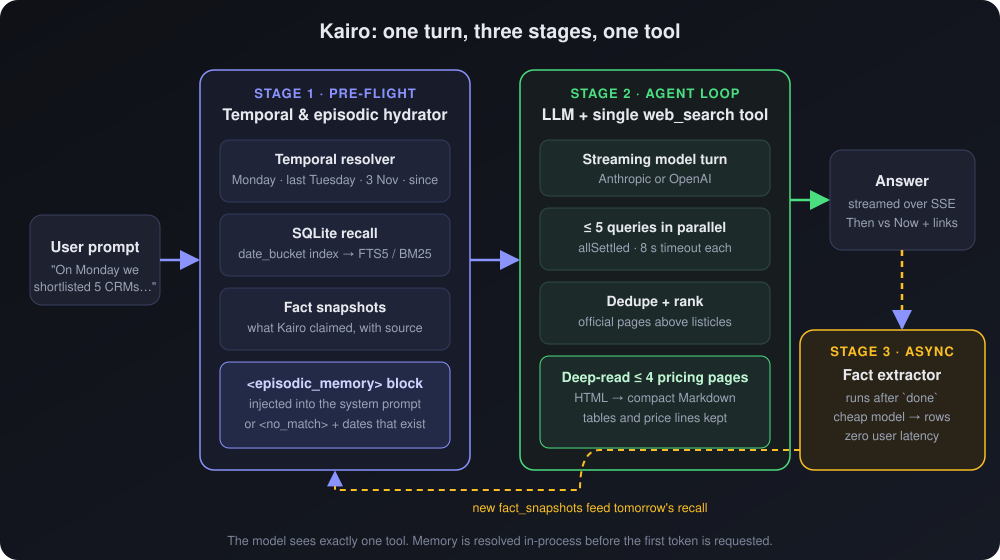
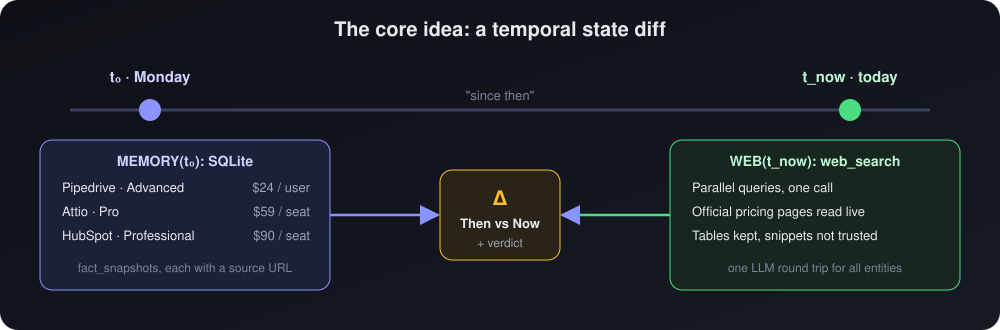
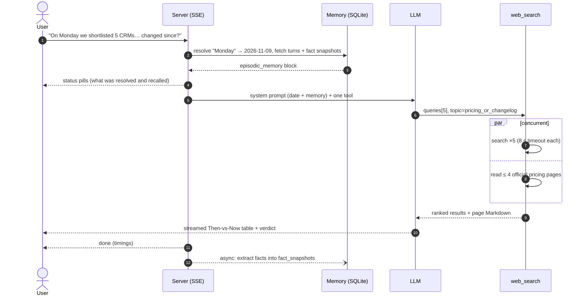
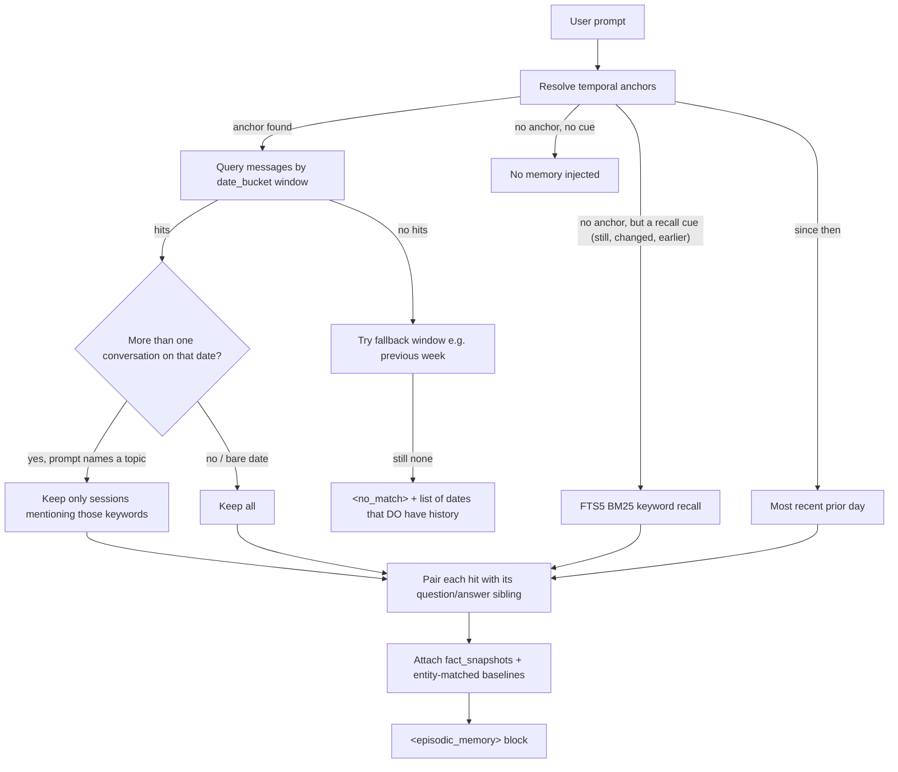
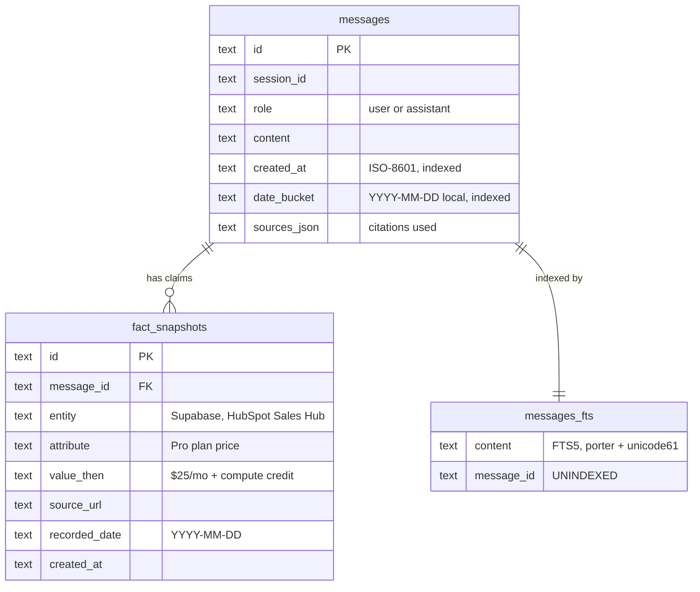

<div align="center">

# ◐ Kairo — Design

**A chat agent with exactly one tool (`web_search`) and a memory that understands time.**

`TypeScript` · `Node 20+` · `SQLite + FTS5` · `SSE streaming` · `Anthropic / OpenAI` · `Tavily / Serper / Exa / no-key`

</div>

<p align="center"></p>

> **The one-minute version.** The challenge prompts ("On Monday we shortlisted 5 CRM tools… anything changed since?") are not searches. They are **state diffs**: *what I told you then* vs *what is true now*. Kairo remembers its past claims in SQLite, resolves "Monday / last Tuesday / 3 November" with date math, hands that memory to the model **before** it starts, and gives it a single batched `web_search` to check the present.

---

## 1 · How it works

<p align="center"></p>

| Stage | Runs | What happens | Where |
|---|---|---|---|
| **1 · Hydrate** | before the model, in-process | Resolve dates → query SQLite by day (else FTS5/BM25) → attach `fact_snapshots` → inject `<episodic_memory>` | `src/memory/` |
| **2 · Search & answer** | streamed | Model calls `web_search` (≤ 5 parallel queries, deep-read official pricing pages) and writes a Then-vs-Now answer with citations | `src/agent/`, `src/tools/` |
| **3 · Ledger** | after `done`, async | A cheap model extracts `(entity, attribute, value, source)` rows linked to the answer | `src/memory/fact-extractor.ts` |



## 2 · Why I built it this way

- **Memory lives in the runtime, not a second tool.** "One tool: web search" is honoured literally (a test asserts the model is offered only `web_search`), and recall costs **no extra model round trip**: it is finished before the first token is requested.
- **Batching lives inside the tool.** Verifying five vendors with one tool call per vendor costs five model round trips. One call with `queries: string[]` costs one. Measured on the no-key path: 2 queries + 2 full page reads ≈ **1 s** end to end.
- **Read the page, not the snippet.** Snippets drop seat minimums, usage tiers and compute add-ons, which creates false "no change" verdicts. A live read of Neon's pricing page already disagrees with the seeded baseline, which a snippet would likely have missed.
- **Structured facts beat transcripts.** A diff needs *claims*; rows with a source URL make a clean Then-vs-Now table and an auditable citation.
- **Time is deterministic and testable.** Date resolution is plain date math, not an LLM guess, and a simulated clock lets anyone backdate a message and test "since then" immediately.

## 3 · What I considered and rejected

| Option | Why not |
|---|---|
| **Vector DB for memory** | Blurs dates and exact names. B-tree date lookup + BM25 is exact, instant, and a single file. |
| **Memory as a 2nd LLM tool** | Breaks "one tool" and adds a model round trip per turn. |
| **Planner / critic agents** | Seconds of extra time-to-first-token and tokens; one parallel tool loop answers in a single pass. |
| **Headless browser per search** | Too slow as the default path; HTTP + DOM stripping first, Jina Reader as the JS-rendered fallback. |
| **LLM-based date parsing** | Non-deterministic and slow; "last Tuesday" must be right every time. |

## 4 · What I'd do with another week

- **Evaluation harness:** replay ~50 multi-session traces and score temporal-recall precision, citation faithfulness and p95 latency, tracked in CI. *Not yet measured: answer quality with a live model. I have only exercised the loop with a scripted LLM.*
- **Page-hash watchers:** hash normalised pricing DOM subtrees of cited URLs to detect changes with no LLM, enabling proactive alerts.
- **Playwright worker pool** for client-rendered pricing calculators.
- **Source-conflict resolver:** when a blog contradicts the vendor's `/pricing`, fetch a tiebreaker and say which wins.
- **Label demo-seed episodes in answers.** Seeded prices are illustrative baselines, not verified history.

---

# Appendix · the details

<details>
<summary><b>Temporal resolver: exact rules</b></summary>

Deterministic date math in `src/memory/temporal-resolver.ts` (chrono-node only as a last-resort fallback). Anchors carry **priority-ordered windows**; the first window with recorded history wins.

| User says | Resolves to | Edge handling |
|---|---|---|
| `On Monday`, `last Monday` | most recent Monday **strictly before today** | If today is Monday → 7 days ago, never "today" |
| `Last Tuesday` | that Tuesday **plus the prior week's** as fallback | Wednesday asking "last Tuesday" still finds yesterday *or* last week |
| `3 November`, `Nov 3`, `November 3rd`, `3rd of Nov`, `Tuesday, 3 November` | most recent Nov 3 on/before today | No year → previous year if still in the future; explicit year respected |
| `2026-11-03` | that day | ISO accepted |
| `yesterday`, `last night`, `day before yesterday` | exact day | |
| `N days / weeks / months ago` | day, ±3 days, ±15 days | "a couple of", "two" etc. understood |
| `last week`, `this week`, `last month` | calendar ranges | Monday–Sunday weeks |
| `since <anything>` | same anchor, flagged `since` | Tells the model to compare then vs now |
| `since then` (no date) | most recent prior day with history | Fallback when no anchor exists |

False positives are tested: "2 decks", "a novel", "sat nav" resolve to nothing.

</details>

<details>
<summary><b>Recall strategy: how memory is chosen</b></summary>



**Same-date collision.** In some years "last Tuesday" *is* 3 November, so two conversations share a day. Topic words ("Postgres") select the right one; a bare date ("3 November") keeps both and the prompt tells the model to say so. Unrelated prompts ("capital of France") inject nothing, so memory never pollutes normal chat.

</details>

<details>
<summary><b>Data model (SQLite, WAL, FTS5)</b></summary>



`date_bucket` makes "everything on 3 November" an index seek. FTS5 gives sub-millisecond BM25 keyword recall. Facts hang off the **assistant message** that made the claim, so they inherit its date. FTS queries are built from sanitised tokens, so hostile input cannot break the parser (tested).

</details>

<details>
<summary><b>The single tool: contract, ranking, deep read</b></summary>

```jsonc
// The ONLY tool the model is ever offered
{ "name": "web_search",
  "input": { "queries": ["…", "…"],                 // 1–5, run concurrently
             "topic": "general | news | pricing_or_changelog",
             "days_back": 14 } }                    // optional recency filter
```

1. **Fan out:** `Promise.allSettled` over all queries, 8 s timeout each. One slow or failing query never blocks the rest, and its error is reported to the model.
2. **Dedupe + rank:** URLs normalised (no `www`, tracking params, fragments, trailing slash); each URL is kept under the query where it scored best.

   | Signal | Effect |
   |---|---|
   | Provider rank | `+1/(position+1)` |
   | Host contains a query entity (e.g. `hubspot` → hubspot.com) | `+3` and tagged `[official]` |
   | Path is `/pricing`, `/plans`, `/changelog`, `/releases` | `+2` (docs/blog `+0.5`) |
   | Review/listicle domains (G2, Capterra, Forbes, Medium…) | `−1.5` |

3. **Deep read** (when `topic = pricing_or_changelog`, or a query contains price/changelog words): best official page per query, max 4, in parallel, 8 s timeout. `page-reader.ts` strips `script/style/nav/footer/form`, keeps headings, lists and **tables** as Markdown, and if the page is over budget keeps every price/plan/limit line instead of truncating blindly. A near-empty (JS-rendered) page is retried through Jina Reader. Results are cached for 10 minutes.
4. **Providers** behind one interface: Tavily → Serper → Exa by key; with no key, DuckDuckGo then Bing. A failing primary silently falls back to the free chain.
5. **Safety:** only public `http(s)` URLs are fetched (no localhost/private ranges), and any tool name other than `web_search` is rejected with an error the model can read.

</details>

<details>
<summary><b>Prompt design: the verification protocol</b></summary>

The system prompt injects the current date and timezone, the `<episodic_memory>` block, and four rules:

1. Memory is authoritative history; if there is a `<no_match>`, say so and name the dates that exist. Never invent a past chat.
2. For "did X change / still correct?": take the baselines from `fact_snapshots`, make **one** batched `web_search` (current year in every query, `days_back` ≈ days elapsed), then answer with a **Then vs Now** table and a verdict.
3. Mark every item `changed`, `no change found`, or `could not verify`. Never assume "no change" when a lookup failed.
4. Search only when live facts are needed; greetings and pure recall ("what did I ask on 3 November?") skip the tool.

If a simulated clock is active, the prompt says live web results still reflect the real present.

</details>

<details>
<summary><b>Latency: what is on the critical path</b></summary>

| Step | On critical path? | Cost |
|---|---|---|
| Date resolution + SQLite recall | yes | in-process, milliseconds (reported to the UI as `memory Nms`) |
| Model call | yes | streams from the first token |
| `web_search` | yes, once per verification | parallel; ≈ 1 s measured for 2 queries + 2 page reads (no-key path) |
| Fact extraction | **no** | starts after `done` |
| Persistence | no | a single SQLite transaction |

The UI shows live "status pills" (resolved dates, recalled messages, parallel searches, pages read) and a timing footer, so the architecture is visible while it runs.

</details>

<details>
<summary><b>Failure modes and how each is handled</b></summary>

| Failure | Behaviour |
|---|---|
| No history for the referenced date | `<no_match>` + dates that exist; the model must say so |
| Empty database | Reported as "memory is empty"; benchmark seeder runs on first boot |
| One query errors or times out | Others return; the error is surfaced to the model |
| Pricing page is JS-rendered or blocks bots | Jina Reader retry, else falls back to snippets and the answer says "could not verify" |
| Search provider key missing/failing | Automatic no-key fallback |
| Model emits an unknown tool | Rejected with a readable error; loop continues |
| Client disconnects | Request aborted; no partial assistant message persisted |
| Fact extraction fails | Logged only; the user's answer is unaffected |

</details>

<details>
<summary><b>Evaluator tooling and verification</b></summary>

- **Benchmark seeder:** on first boot, plants three conversations anchored to *today's* calendar (last Monday: 5 CRM tools · most recent 3 November: hosted-LLM pricing · last Tuesday: Postgres hosting) with fact snapshots, so the challenge prompts work on any date. Prices are illustrative baselines for the "then" side.
- **Timeline & Seed Manager** (`Cmd/Ctrl+K`): browse stored days and facts, simulate sending a message *as of* a past date, re-seed, reset. `POST /api/debug/context` prints exactly what memory would be injected for a prompt.
- **Tests (24, no API key needed):** resolver across several "today" values including Monday/Tuesday/Wednesday edge cases; the three benchmark prompts recall the right episode; same-date collision; FTS safety; one-tool guarantee; unknown-tool rejection; parallel search with partial failure; ranking; HTML → Markdown; time-travel round trip. They use a scripted LLM, so they verify the plumbing, not model quality.

</details>
