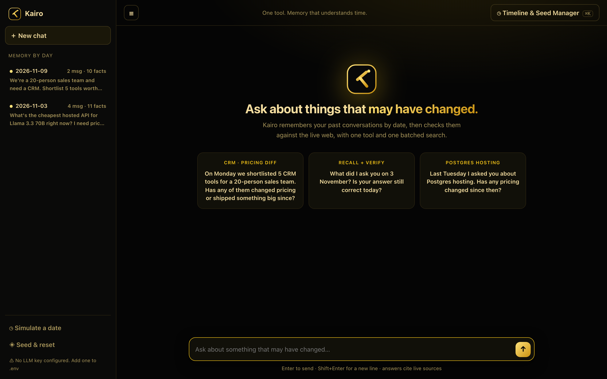
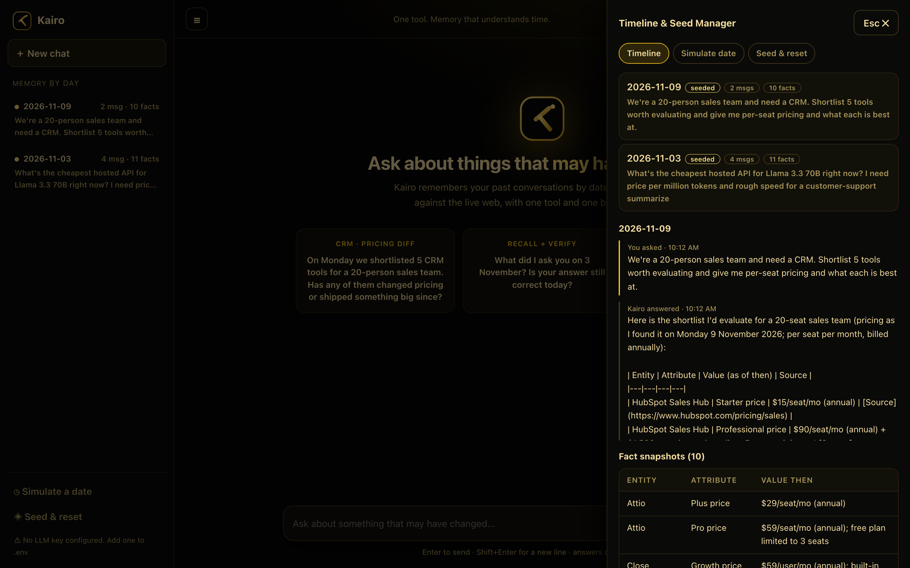
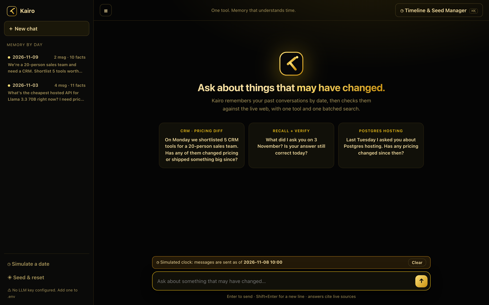
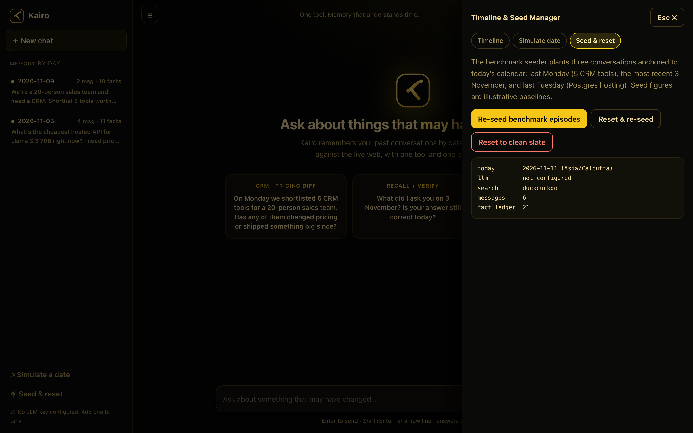
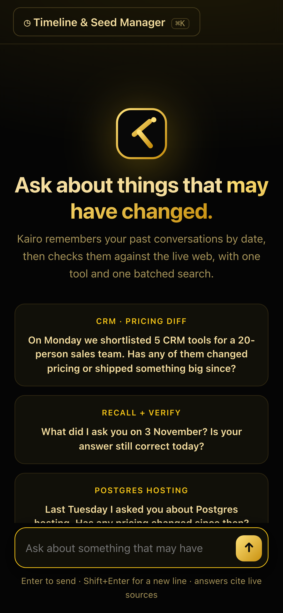
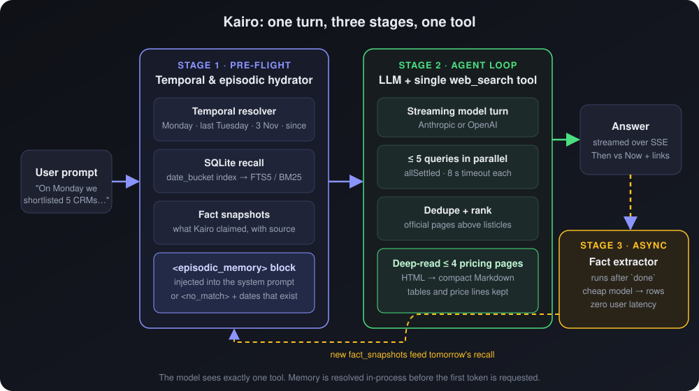

<div align="center">


# Kairo

**A chat agent with exactly one tool, `web_search`, and a memory that understands time.**

Ask *"On Monday we shortlisted 5 CRM tools. Has any of them changed pricing since?"*<br>
Kairo recalls what it told you on Monday, checks the live web in one batched search, and answers with a **Then vs Now** comparison.




</div>

---

## Contents

1. [Overview](#overview)
2. [Highlights](#highlights)
3. [Screenshots](#screenshots)
4. [Quick start](#quick-start)
5. [Configuration](#configuration)
6. [Try the benchmark prompts](#try-the-benchmark-prompts)
7. [How it works](#how-it-works)
8. [HTTP API](#http-api)
9. [Project structure](#project-structure)
10. [Development and testing](#development-and-testing)
11. [Limitations](#limitations)

## Overview

Questions like *"has anything changed since Monday?"* are not plain web searches. They are **state diffs**: what the agent said *then* versus what is true *now*. Kairo is built around that idea:

- It **remembers** every conversation in SQLite, indexed by calendar day, with a ledger of the concrete claims it made (prices, tiers, limits, versions).
- It **resolves time** ("Monday", "last Tuesday", "3 November", "since then") with deterministic date math, then hands the matching memory to the model before it starts.
- It gives the model **one tool**: a batched, parallel `web_search` that deep-reads official pricing pages.

The full reasoning, rejected alternatives and diagrams are in **[DESIGN.md](DESIGN.md)**.

## Highlights

| | |
|---|---|
| **One tool, literally** | The model is offered only `web_search`. Memory is resolved in-process, so recall costs no extra model round trip. |
| **Temporal memory** | Date resolution + indexed day lookup + FTS5/BM25 keyword recall + a structured fact ledger. |
| **Fast verification** | Up to 5 queries run in parallel; official pricing pages are read and compressed to Markdown tables, not trusted as snippets. |
| **Speculative prefetch** | For "did it change?" prompts, memory already names the entities, so the search starts *before* the model call. |
| **Async fact ledger** | New claims are extracted after the answer is sent, adding no user-visible latency. |
| **Time-travel tools** | Backdate a message to any date, browse stored days, re-seed or reset, all from the UI. |
| **Provider-flexible** | Anthropic or OpenAI for the model; Tavily, Serper, Exa or a no-key fallback for search. |

## Screenshots

<table>
<tr>
<td width="50%"><br><sub><b>Timeline.</b> Every stored day, its messages, and the fact snapshots recorded that day.</sub></td>
<td width="50%"><br><sub><b>Time travel.</b> Send a message as of a past date, then ask what changed since.</sub></td>
</tr>
<tr>
<td width="50%"><br><sub><b>Seed &amp; reset.</b> Plant benchmark episodes, reset, and inspect engine status.</sub></td>
<td width="50%" align="center"><br><sub><b>Mobile.</b> Responsive down to phone width.</sub></td>
</tr>
</table>

## Quick start

```bash
npm install
cp .env.example .env     # add ONE LLM key (Anthropic or OpenAI)
npm run dev              # → http://localhost:3000
```

The server, the API (SSE streaming) and the UI run in a single process on one port. There is no build step.

> **Requirements:** Node 20 or newer. SQLite is bundled through `better-sqlite3`; nothing else to install.

## Configuration

Only one LLM key is required. Blank values and `...` placeholders are ignored.

| Variable | Purpose | Default |
|---|---|---|
| `ANTHROPIC_API_KEY` | Use Anthropic (checked first) | none |
| `OPENAI_API_KEY` | Use OpenAI when there is no Anthropic key | none |
| `LLM_MODEL` | Main model override | `claude-sonnet-4-5` / `gpt-4o` |
| `LLM_FAST_MODEL` | Cheap model for background fact extraction | `claude-haiku-4-5` / `gpt-4o-mini` |
| `TAVILY_API_KEY` | Search provider (recommended) | none |
| `SERPER_API_KEY` | Search provider | none |
| `EXA_API_KEY` | Search provider | none |
| `KAIRO_PREFETCH` | `off` disables speculative prefetch (for latency A/B tests) | `on` |
| `PORT` | HTTP port | `3000` |

**Search provider order:** Tavily, then Serper, then Exa, whichever key is present. With no search key, Kairo uses a free DuckDuckGo/Bing chain plus Jina Reader for JavaScript-heavy pages. That is fine for demos; a real key is more reliable because free endpoints can rate-limit or show CAPTCHAs.

## Try the benchmark prompts

On first boot an empty database is seeded with three conversations anchored to **today's calendar**, so the challenge prompts work on any date.

| Seeded episode | Date |
|---|---|
| Shortlist of 5 CRM tools for a 20-person sales team | most recent Monday |
| Hosted Llama 3.3 70B pricing question | most recent 3 November |
| Postgres hosting comparison (Supabase, Neon, RDS, Render, Railway) | last Tuesday |

Click a suggestion card in the UI, or paste:

1. *On Monday we shortlisted 5 CRM tools for a 20-person sales team. Has any of them changed pricing or shipped something big since?*
2. *What did I ask you on 3 November? Is your answer still correct today?*
3. *Last Tuesday I asked you about Postgres hosting. Has any pricing changed since then?*

> Seeded prices are **illustrative baselines** for the "then" side of the comparison. The "now" side always comes from live search.
> In some years "last Tuesday" and "3 November" are the same date. Kairo then uses topic words to pick the right conversation, and keeps both for a bare date.

**Timeline & Seed Manager** (header button or `Cmd/Ctrl + K`): browse stored days and fact snapshots, simulate a message *as of* a past date, re-seed the benchmark, or wipe to a clean slate.

## How it works

<p align="center"></p>

1. **Hydrate.** Dates in your message are resolved to windows, and matching past turns plus their stored facts are injected into the prompt as `<episodic_memory>`. If nothing matches, the model is told which dates *do* have history.
2. **Prefetch** (verification questions only). When memory already names the entities, the runtime runs the batched search before the model starts and gives the model a completed tool result.
3. **Search and answer.** The model streams a **Then vs Now** answer with citations, and can call `web_search` again for gaps.
4. **Ledger.** After the answer is sent, a background pass records the new claims for future comparisons.

Details, decisions and rejected alternatives: [DESIGN.md](DESIGN.md).

## HTTP API

| Endpoint | Description |
|---|---|
| `POST /api/chat` | `{ message, sessionId?, asOf? }` → SSE events: `status`, `delta`, `sources`, `done`, `error` |
| `GET /api/status` | Provider, model, counts, today's date |
| `GET /api/timeline` · `GET /api/timeline/:date` | Stored days; messages and facts for one day |
| `POST /api/debug/context` | `{ message, asOf? }` → exactly what memory would be injected for that prompt |
| `POST /api/seed` · `POST /api/reset` | Re-seed benchmark episodes · reset (`{ "seed": true }` to re-seed) |

## Project structure

```
src/
├── server.ts                  Express + SSE endpoints, first-boot seeding
├── config.ts                  Env parsing and provider selection
├── agent/
│   ├── orchestrator.ts        Streaming loop; the model is offered one tool
│   ├── prefetch.ts            Plans the speculative batched search from remembered entities
│   ├── prompts.ts             System prompt: date grounding + verification protocol
│   └── llm.ts                 Anthropic and OpenAI streaming adapters
├── memory/
│   ├── db.ts                  SQLite schema (WAL, FTS5) and queries
│   ├── temporal-resolver.ts   "Monday", "last Tuesday", "3 Nov" → date windows
│   ├── context-assembler.ts   Pre-flight recall → <episodic_memory> block
│   ├── fact-extractor.ts      Async post-turn claim extraction
│   ├── seed.ts                Benchmark seeder, anchored to today
│   └── dates.ts               Local-calendar helpers
├── tools/
│   ├── web-search.ts          The single tool: parallel queries, ranking, deep read
│   ├── providers.ts           Tavily / Serper / Exa / free fallback
│   └── page-reader.ts         HTML → compact Markdown (tables and prices kept)
└── public/                    Zero-build UI (index.html, styles.css, app.js, logo.svg)
test/                          33 tests; no API keys needed
docs/                          Logo, architecture diagrams and screenshots
```

## Development and testing

| Command | What it does |
|---|---|
| `npm run dev` | Start with auto-reload (`tsx watch`) |
| `npm start` | Start without watching |
| `npm run typecheck` | `tsc --noEmit` (strict) |
| `npm test` | Run the test suite with a scripted LLM, so it needs no keys |

The tests cover date resolution across several "today" values, recall for all three benchmark prompts, the one-tool guarantee, parallel search with partial failures, ranking, HTML-to-Markdown, prefetch planning and fallbacks, and the time-travel round trip.

## Limitations

- Tests verify the plumbing, not the model's answer quality.
- Time travel backdates **messages**, not the web: live results always reflect the real present.
- Data lives in `./data/kairo.db`. Delete the folder, or use the reset button, to start fresh.
- Date parsing is English-only.
